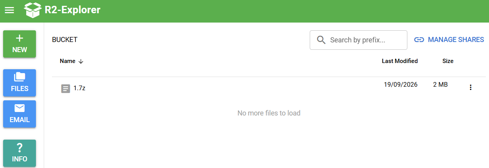
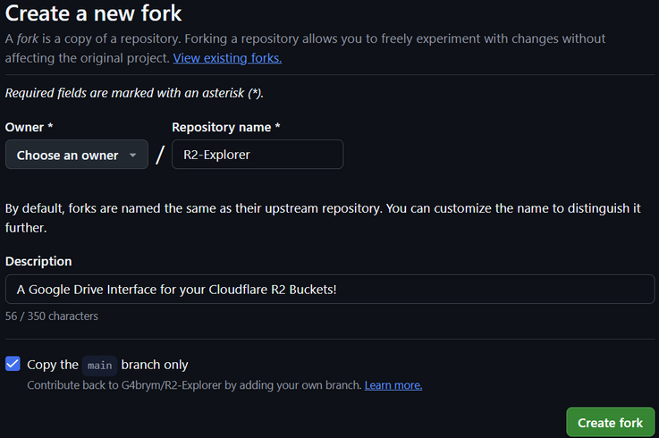
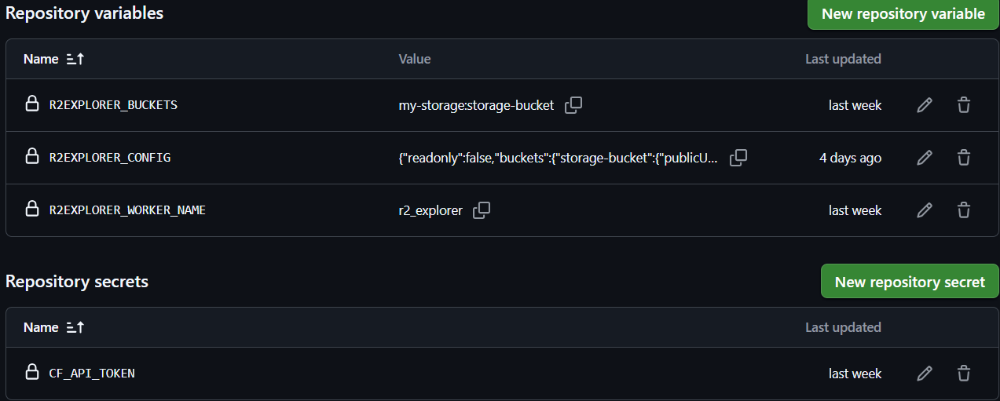
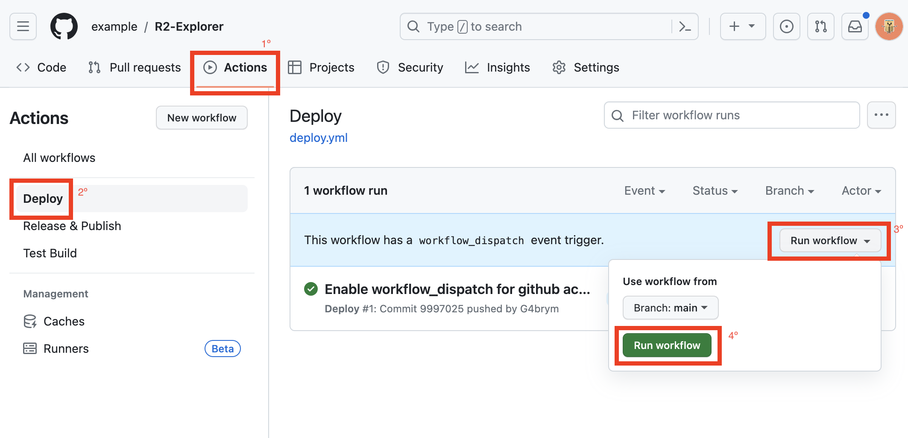
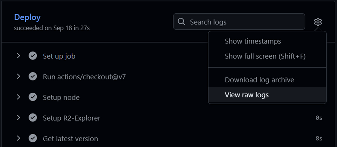
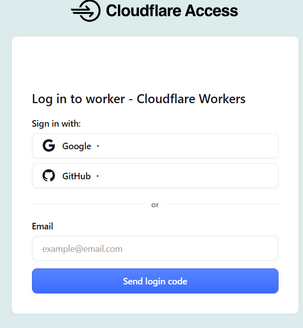

## Background

I wanted to set up some self-hosted cloud storage and discovered a nice offering by CloudFlare where the first 10GB of R2 storage is [free](https://developers.cloudflare.com/r2/pricing/#free-tier){:target="_blank"}. I subsequently stumbled upon [`r2-explorer`](https://github.com/G4brym/R2-Explorer){:target="_blank"} , which acts as a Google-Drive like interface making it more user-friendly, containing handy features such as user authentication and expiring sharing links.


_The UI is simple and clean_

The rest of the article describes how unsafe defaults and misleading documentation, combined with our ever shortening attention spans and dopamine loops could lead to security compromise, despite the application not inherently containing any vulnerable code .


##  The Footgun(s)

The [Create a New Project](https://r2explorer.com/getting-started/creating-a-new-project){:target="_blank"} [page](https://archive.is/RvfE2){:target="_blank"} shares three methods to take home and implement your own copy of `r2-explorer`:  
- GitHub Actions (GHA)
- `create-cloudflare` Node package
- Manual

Github Actions is by far the **<u>easiest</u>** and most straightforward option out of all three as the other two options require a local Node environment to dev/publish the application, whereas with GitHub Actions everything lives in the rpeo, and the build process is performed directly via GHA CI/CD. Ironically, it is also currently the most **<u>insecure</u>** option as we will explore further below...  

### GitHub Actions (GHA)

Most of the setup is solid except for these 3 areas, which immediately become gotchas if you don't work with GitHub or CI/CD on the regular (guilty as charged).

#### Fork

The very first step of the docs for GHA asks the user to fork the repository:

{: .prompt-info }
> > Start by creating a new fork of the [github repository here](https://github.com/G4brym/R2-Explorer/fork).  
> - [Create a New Project](https://r2explorer.com/getting-started/creating-a-new-project){:target="_blank"} page


_I happily forked the repo and continued with my business_

But as technicalities go, forks of public repositories will always be [public](https://docs.github.com/en/pull-requests/reference/forks#visibility-of-forks), this is the default behavior and there is no way to make a public fork private.

{: .prompt-warning}
> This is important because the public nature of forks is a compounding factor into the next two sections.

#### Hardcode The Configurations?

The documentation encourages users to add authentication to the application, great!  

{: .prompt-info }
> > To enable this feature, update your `src/index.ts` file with the desired usernames and passwords.  
>   
> ```ts
>  import { R2Explorer } from 'r2-explorer';
>
>  export default R2Explorer({ readonly: false, basicAuth: [{
>     username: 'teste',
>     password: 'abc'
>   },{
>     username: 'anotherUser',
>     password: '123567'
>   }]
> );
> ```  
>  
> - [Getting Started](https://r2explorer.com/getting-started/security#basic-auth){:target="_blank"} page

The above here is slightly misleading as this is not the only way to specify configurations, (especially when plaintext credentials are involved); you could also specify them in the `R2EXPLORER_CONFIG` environment variable. More on that later...  

{: .prompt-danger}
> At this point, the configurations could be stored and publicly viewed from a repo's `src/index.ts` file.

#### Vars

Following the setup, we define several repository secrets and variables:
> - `R2EXPLORER_WORKER_NAME` this is the worker named used to identify the worker in your Cloudflare account.
> - `R2EXPLORER_CONFIG` object with the R2-explorer configuration, read more here.
> - `R2EXPLORER_BUCKETS` buckets in the format {r2-explorer name}:{bucket name}[:{jurisdiction}], define one bucket per line. The jurisdiction parameter is optional and can be used to specify the R2 bucket jurisdiction (e.g., eu for European Union).
> - `R2EXPLORER_DOMAIN` optional domain name used to serve the R2-explorer instance, when not set, you will be given a workers.dev domain.


_Everything looks to be in order?_

The hidden danger here is that `R2EXPLORER_CONFIG` contains the following sensitive [config](https://r2explorer.com/getting-started/configuration){:target="_blank"} options:
- `basicAuth` - see above
- `publicUrl` - _"Expose the contents of this R2 bucket to the internet through the Public Development URL when enabled."_ -- explained best by the CloudFlare [docs](https://developers.cloudflare.com/r2/buckets/public-buckets/#public-development-url){:target="_blank"}


#### Logs

Once everything is setup, we make our first dpeloyment and see that everything works, hooray!  

_as per documentation_ 

Unfortunately, most users do not think to check the logs at this point. I didn't at first until I got curious.


_So what are in the logs?_


```sh
2026-09-18T11:36:02.0869820Z node packages/github-action/prepareDeploy.js
2026-09-18T11:36:02.0919967Z shell: /usr/bin/bash -e {0}
2026-09-18T11:36:02.0920305Z env:
2026-09-18T11:36:02.0920624Z   NPM_CONFIG_USERCONFIG: /home/runner/work/_temp/.npmrc
2026-09-18T11:36:02.0921045Z   R2EXPLORER_WORKER_NAME: r2-explorer
2026-09-18T11:36:02.0921688Z   R2EXPLORER_CONFIG: {
  "readonly": false,
  "basicAuth": {
    "username": "admin",
    "password": "<REDACTED_PASSWORD_FOR_BLOG>"           # <--------
  }
}
2026-09-18T11:36:02.0922311Z   R2EXPLORER_BUCKETS: files:pan
2026-09-18T11:36:02.0922618Z   R2EXPLORER_DOMAIN: 
2026-09-18T11:36:02.0923186Z   CF_API_TOKEN: ***
   .....8<......
2026-09-18T11:36:02.1258980Z import { R2Explorer } from "r2-explorer";
2026-09-18T11:36:02.1259229Z 
2026-09-18T11:36:02.1259391Z export default R2Explorer({
2026-09-18T11:36:02.1259714Z   "readonly": false,
2026-09-18T11:36:02.1260002Z   "basicAuth": {
2026-09-18T11:36:02.1260275Z     "username": "admin",
2026-09-18T11:36:02.1260576Z     "password": "<REDACTED_PASSWORD_FOR_BLOG>"
2026-09-18T11:36:02.1260904Z   }
2026-09-18T11:36:02.1261139Z });
   .....8<......
2026-09-18T11:36:19.4573390Z Deployed r2-explorer triggers (0.50 sec)
2026-09-18T11:36:19.4574161Z   https://REDACTED_URL.workers.dev   # <--------
```

{: .prompt-info }
> Notice that `CF_API_TOKEN` is masked as it is set as a repository **secret**, whereas `R2EXPLORER_CONFIG` is cleartext as it was set as a repository **variable**.  
> The application URL is also 


## Impact

It depends on the the [Security](https://r2explorer.com/getting-started/security){:target="_blank"} configuration chosen for the target implementation.

#### CloudFlare Access

{: .prompt-tip}
> > Cloudflare Access is a Zero Trust Network Access (ZTNA) identity-aware proxy that verifies user identity, device posture, and context before granting access to applications and infrastructure.
> 
> [**Cloudflare Access**](https://r2explorer.com/getting-started/security#authenticating-with-cloudflare-access){:target="_blank"} deployments are not really affected since there are no plaintext credentials in the config. The `cfAccessTeamName` config value is just an identifier and its exposure doesn't lead to access.  
>   
> 
> _CloudFlare Access sits infront as an authentication barrier enforcing user-auth to predefined users in the CloudFlare dashboard._  

#### Basic Auth

{: .prompt-danger}
> [**Basic Auth**](https://r2explorer.com/getting-started/security#basic-auth){:target="_blank"} users face the most impact, as the plaintext creds would be stored in the logs or `src/index.ts` file. 
> - It has no audit trail so you can't tell who logged in and from where
> - It also has no server-side component so you cannot perform account lockouts etc.
>
>  --- 
>   
> ##### My other R2 is Your R2
> 
> It goes without saying that someone that logs in as you can:
> - read and download all your uploaded files
> 
> If `readOnly` was set to `false`, they can also: 
>  - modify and delete your files
>   - upload additional files, which will incur costs if total size > 10GB.

{: .prompt-warning}
> As an aside, even if no credentials are available or CloudFlare Access is used, the public URL being known also allows determined attackers to enumerate endpoints/files from the underlying bucket, although this has to be manually enabled on the CloudFlare side so it's not always available. 


## How bad is it?

{: .prompt-warning} 
> Well, for starters... I fell for it myself too. That's how I found these footguns to begin with.

The exposure is a rolling problem where the recent affected users of this repo are exposed for ~90 days (or longer) at a time. So every passing day, new batches of affected users will surface.

> Across the `09/26`-`11/26` period that I surveyed, I found roughly `10` disclosures, `5` still had live deployments.


## Reproduction Steps

1. Go to the [`r2-explorer`](https://github.com/G4brym/R2-Explorer){:target="_blank"} repo  
2. Look under [forks](https://github.com/G4brym/R2-Explorer/forks){:target="_blank"}
3. Set Period to `6 months` and Sort by `Recently updated`
4. Go to any repo you're interested in
5. Look at Actions tab
6. For any deployments within _90 days_, look for raw logs  
7. grep logs for `username`, `password` and `workers.dev`/`(custom domain)`.  


## Mitigation and Remediation advice

{: .prompt-tip}
> I wrote up some [security adjustments](#){:target="_blank"} which are further explained below.   
> All of the following mitigation changes should <u>always be followed-up by a redeploy</u>.

### Public Fork Exposure
- Mitigation:
  - Rotate any/all credentials that were hardcoded or leaked (including Public R2 URLs)
  - Delete the public fork and reupload in a private repo (this is the most cost-effective method of all)
- Remediation:
  - Update the documentation; warning users that forks will be **public** by default
    - As such -- configuration details will be publicly viewable (up to 90 days for deploy logs).
    - Recommend users to secure their configurations or opt for private reuploads
  
### Vars vs Secrets
- Mitigation:
  - Prefer using CloudFlare Access over Basic Auth
- Remediation:
  - The CI build should omit logging `R2EXPLORER_CONFIG` if it contains `basicAuth` or `publicUrl`
  
### Log Exposures
- Mitigation:
  - After each deployment, manually delete logs from GitHub, don't leave it up to the 90 days expiry.
- Remediation:
  - Add a new `logLevel` configuration variable allowing users to define deployment logging behavior, ie:
    - `verbose` - Logs everything **(avoid in prod/public envs)**
    - `default` - Never logs identifiable information

### Unauthorized Access
- Detection:
  - More of a response measure, but it is worth setting an [R2 budget alert](https://developers.cloudflare.com/billing/manage/budget-alerts/){:target="_blank"}, so that if costs unexpectedly pass a `$0.01` threshold you can respond accordingly.


## Conclusion
  
In the age of AI and agentic coding, "moving fast and breaking things" without fully understanding the underlying/surrounding context could lead to unexpected and dangerous side effects.  
  
I believe this footgun is a shared repsonsibility between the maintainer as well as users of the application: 
- Maintainers should offer **secure-by-default** configurations for others to implement.
- Users should engage their critical thinking and maintain a level of skepticism of what they are building and take time to understand any caveats involved in the process.  
